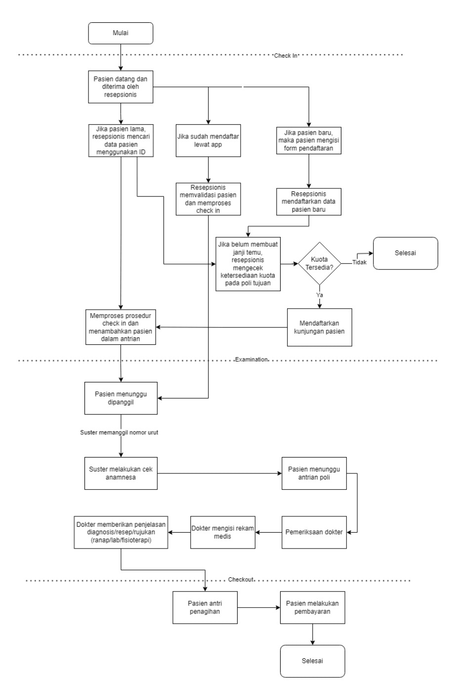

## BACKGROUND
> berfungsi untuk menjelaskan konteks dan alasan utama mengapa sistem informasi ini diperlukan

Klinik praktek bersama dokter spesialis merupakan salah satu bentuk layanan kesehatan yang semakin dibutuhkan oleh masyarakat dalam memenuhi kebutuhan medis yang spesifik. Klinik ini tidak hanya melayani konsultasi medis, tetapi juga memberikan diagnosis, perawatan, dan tindak lanjut yang membutuhkan koordinasi antara berbagai spesialis medis. Seiring dengan peningkatan jumlah pasien dan kompleksitas pengelolaan data medis, diperlukan sebuah sistem informasi manajemen yang efisien dan terintegrasi untuk mendukung operasional klinik secara optimal.

Saat ini, klinik masih menggunakan metode manual untuk mengelola pendaftaran pasien, penjadwalan konsultasi, pencatatan rekam medis, pengelolaan stok obat, serta penagihan dan pembayaran. Sistem ini sering kali menyebabkan masalah seperti kesalahan pencatatan, duplikasi data, dan kesulitan dalam mengakses informasi secara cepat dan akurat. Selain itu, proses manual cenderung menghabiskan waktu lebih lama, yang berdampak pada efisiensi layanan kepada pasien.

Oleh karena itu, dibutuhkan sebuah sistem informasi manajemen klinik yang dapat mengintegrasikan seluruh proses operasional klinik, mulai dari pendaftaran pasien, manajemen jadwal dokter, pencatatan rekam medis elektronik, hingga pengelolaan keuangan. Dengan adanya sistem yang terintegrasi, diharapkan klinik dapat meningkatkan efisiensi operasional, memberikan layanan yang lebih baik kepada pasien, dan memastikan keamanan serta kerahasiaan data pasien.

## OBJECTIVES

> berfungsi untuk merinci tujuan yang ingin dicapai melalui pengembangan dan implementasi sistem informasi

Pengembangan sistem informasi manajemen klinik praktek bersama dokter spesialis ini bertujuan untuk mencapai hal-hal berikut:
1. Meningkatkan Efisiensi Operasional
   Mengotomatisasi proses administrasi klinik, seperti pendaftaran pasien, penjadwalan konsultasi, pencatatan rekam medis, dan proses penagihan. Dengan sistem yang terintegrasi, waktu dan upaya yang dibutuhkan untuk mengelola proses-proses ini dapat dikurangi secara signifikan, sehingga meningkatkan produktivitas klinik.
2. Meningkatkan Akurasi dan Keamanan Data
   Memastikan bahwa semua data pasien, rekam medis, dan informasi terkait lainnya dicatat dan disimpan secara akurat dan aman. Sistem ini juga akan mengurangi risiko kesalahan manusia, duplikasi data, serta memastikan bahwa data hanya dapat diakses oleh pihak yang berwenang.
3. Meningkatkan Kualitas Layanan Pasien
   Mempercepat dan mempermudah akses informasi medis yang dibutuhkan oleh dokter dan staf klinik, sehingga mereka dapat memberikan layanan yang lebih cepat dan tepat kepada pasien. Selain itu, sistem ini juga memungkinkan pasien untuk lebih mudah mengatur janji temu dan memonitor riwayat medis mereka.
4. Mendukung Pengambilan Keputusan yang Lebih Baik
   Menyediakan data dan laporan yang komprehensif dan real-time, yang dapat digunakan oleh manajemen klinik untuk mengambil keputusan yang lebih informasional terkait operasional, perencanaan strategis, dan pengelolaan sumber daya klinik.
5. Memfasilitasi Kolaborasi Antar Dokter Spesialis
   Memungkinkan para dokter spesialis di klinik untuk berbagi informasi medis dan berkolaborasi dalam penanganan pasien dengan lebih mudah dan terintegrasi, sehingga dapat memberikan perawatan yang lebih holistik dan efektif.
6. Memenuhi Regulasi dan Standar Kesehatan
   Memastikan bahwa semua proses yang didukung oleh sistem ini mematuhi peraturan dan standar kesehatan yang berlaku, termasuk perlindungan data pasien, agar klinik dapat beroperasi sesuai dengan persyaratan hukum dan etika medis.

## PROJECT SCOPE

> bertujuan untuk menjelaskan batasan dan cakupan proyek

1. Sistem dan Dokumentasi
    - Pembuatan sistem informasi sesuai dengan kebutuhan fungsi/fitur yang telah dijelaskan secara detail pada bagian “BUSINESS REQUIREMENT” dalam dokumen ini.
    - Sistem informasi diuji dengan 3 jenis pengujian yang meliputi pengujian internal oleh tim QA (Quality Assurance) proyek, pengujian SIT (System Integration Testing) oleh tim IT dari pihak customer dan pengujian oleh pengguna atau UAT (User Acceptance Testing).
    - Pembuatan sistem disertai dengan dokumen-dokumen yang dibutuhkan dalam menunjang keberlanjutan sistem, seperti pemeliharaan dan pelatihan pengguna.
2. Strategi Implementasi Sistem
    - Implementasi sistem di klinik, termasuk pelatihan pengguna dan dukungan teknis awal.
3. Sumber Daya Pendukung
    - Proyek ini dikembangkan oleh tim proyek yang terdiri dari project manager dan 6 anggota tim lainnya. (detail anggota tim dapat dilihat dalam proposal tim BD atau project charter)
    - Segala aplikasi pendukung pengembangan sudah termasuk ke dalam skema biaya proyek (detail dapat dilihat dalam dokumen project charter atau sales quotation).
    - Hardware dan jaringan pendukung baik saat pengembangan maupun pemeliharaan dalam jangka waktu garansi, sudah termasuk ke dalam skema biaya proyek (detail dapat dilihat dalam dokumen project charter atau sales quotation).
4. Keamanan dan Kepatuhan
    - Implementasi protokol keamanan untuk melindungi data pasien dan informasi sensitif lainnya.
    - Memastikan sistem sesuai dengan regulasi kesehatan yang berlaku, seperti HIPAA (Health Insurance Portability and Accountability Act) atau standar lokal yang relevan.
    - Fitur audit dan log aktivitas untuk memantau akses dan perubahan data.

## BUSINESS REQUIREMENT

> berfungsi untuk menjelaskan kebutuhan atau fungsi apa saja yang dibutuhkan dalam sistem

Klinik ibu dan anak : poli obgyn, pediatric, umum, gigi

1. Modul Pendaftaran Pasien
    1. Pembuatan sistem pendaftaran pasien baru dan pengelolaan data pasien yang sudah ada.
    2. Integrasi dengan sistem penjadwalan untuk memfasilitasi pembuatan janji temu.
    3. Otomatisasi pengiriman notifikasi dan pengingat janji temu kepada pasien.
2. Modul Manajemen Jadwal Dokter
    1. Pembuatan sistem penjadwalan yang fleksibel untuk dokter spesialis.
    2. Pengelolaan ketersediaan jadwal dokter, termasuk penyesuaian dan pembatalan janji temu.
    3. Integrasi dengan kalender dokter dan pemberitahuan kepada pasien jika terjadi perubahan jadwal.
3. Modul Rekam Medis Elektronik (Electronic Medical Record/EMR)
    1. Pengembangan dan penyimpanan rekam medis pasien dalam bentuk digital.
    2. Kemampuan untuk mengakses dan memperbarui rekam medis oleh dokter dengan izin yang tepat.
    3. Fitur untuk mendukung pencatatan diagnosis, resep obat, dan hasil laboratorium.
4. Modul Penagihan dan Pembayaran
    1. Otomatisasi proses penagihan untuk layanan yang diberikan kepada pasien. Kontak by email atau wa
    2. Integrasi dengan sistem pembayaran, baik tunai maupun non-tunai. Non-tunai by trf antar bank
    3. Pembuatan laporan keuangan yang terkait dengan pendapatan dan pengeluaran klinik.
5. Modul Laporan dan Analitik
    1. Pengembangan dasbor (dashboard) yang menyediakan laporan operasional, keuangan, dan statistik kesehatan.
    2. Laporan yang dapat disesuaikan sesuai kebutuhan manajemen klinik. Laporan dari manajemen

## PROJECT CONSTRAINT

> berfungsi untuk menjelaskan aspek-aspek yang tidak termasuk dalam proyek ini

1. Pengembangan fitur atau modul tambahan yang tidak disebutkan di atas akan dipertimbangkan sebagai proyek terpisah.
2. Integrasi dengan sistem eksternal atau platform pihak ketiga yang tidak secara eksplisit disebutkan dalam lingkup proyek ini.
3. Dukungan pasca-implementasi di luar periode garansi yang disepakati.
